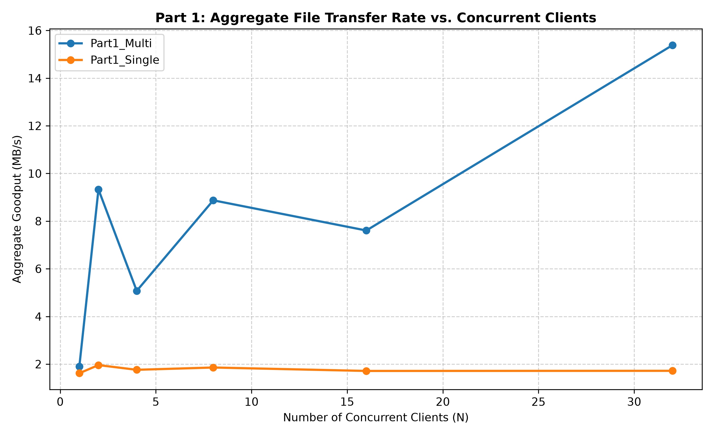
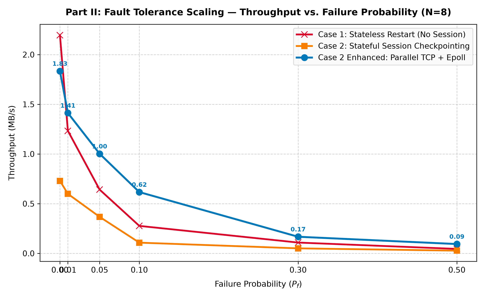
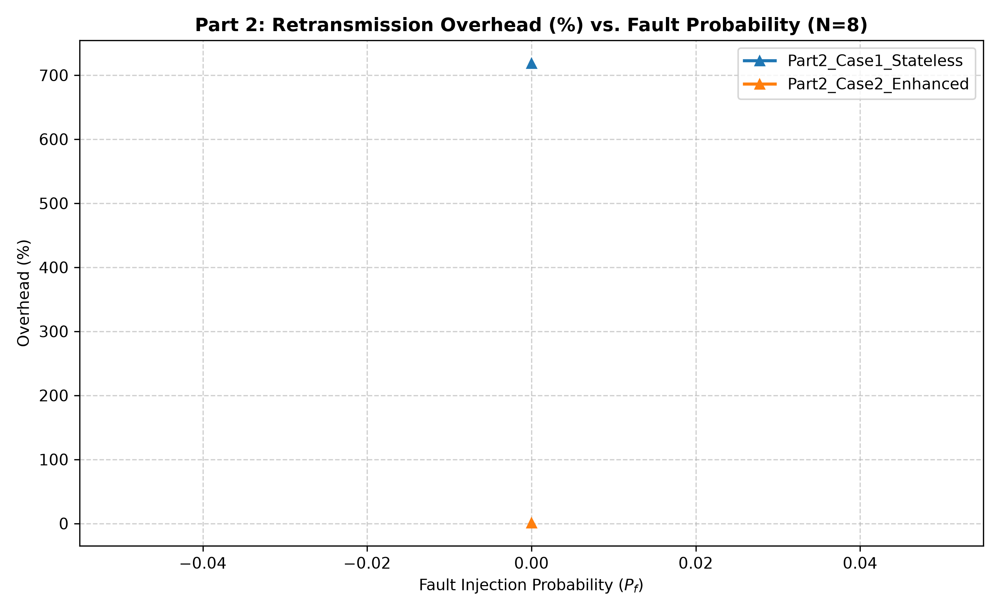

# 📡 IT305 Lab — Fault-Tolerant Topic-Based File Distribution Service

> **Course:** IT305 — Computer Networks Lab
> **Submission Deadline:** October 23, 2026
> **Groups:** Group 103 & Group 106 (Merged)
> **Language:** C++17 · POSIX sockets · Linux/WSL

---

## 👥 Group Members & Contributions

| Roll No. | Name | Group | Wave | Primary Contribution |
|---|---|---|---|---|
| 202401496 | Vaghela Khush | G-106 | Wave 1 | Server data structures, CLI parsing & execution loops |
| 202401412 | Yuvraj Chauhan | G-103 | Wave 1 | Length-prefixed wire framing & message formats (all cases) |
| 202401491 | Vekariya Bhavya | G-106 | Wave 2 | Chunk-boundary fault injection & Case 1 stateless recovery |
| 202401476 | Shlok Gohel | G-103 | Wave 2 | Case 2 session management, durability invariant & validation |
| 202401444 | Digvijy Parmar | G-103 | Wave 3 | Design trade-offs, extra features, instrumentation & integration |
| 202401492 | Vekariya Nisarg | G-106 | Wave 3 | Case 2 Enhanced: parallel TCP, epoll, sendfile & bitmask recovery |

---

## 🗂️ Repository Layout

```
GH_Project/
│
├── 📁 Part1/                        ← Part I  : Reliable single/multi-threaded server
│   ├── server.cpp                   ← Thread-per-client & single-threaded modes
│   ├── client.cpp                   ← Basic topic fetch client
│   ├── protocol.{h,cpp}             ← Wire-framing layer (shared across all parts)
│   ├── directory_mapper.{h,cpp}     ← Topic → file-list resolver
│   ├── concurrency.{h,cpp}          ← Thread pool & accept-loop helpers
│   ├── metrics_logger.{h,cpp}       ← CSV goodput / overhead logger
│   ├── fault.{h,cpp}                ← Fault injection (stub — disabled in Part 1)
│   └── Makefile
│
├── 📁 Part2_Case1/                  ← Part II Case 1 : Stateless retry (no session)
│   ├── server.cpp                   ← Server drops conn after injected fault
│   ├── client.cpp                   ← Bounded-retry loop (max 5 attempts / topic)
│   ├── fault.{h,cpp}                ← Probabilistic mid-chunk fault injection
│   └── ...                          ← (same header set as Part1)
│
├── 📁 Part2_Case2/                  ← Part II Case 2 : Stateful resume (128-bit session)
│   ├── server.cpp                   ← Checkpoint-aware server
│   ├── client.cpp                   ← RESUME / CKPT_ACK client
│   ├── session.{h,cpp}              ← 128-bit session ID, checkpoint state machine
│   ├── checkpoint.{h,cpp}           ← Disk-durable .ckpt file manager
│   └── ...
│
├── 📁 Part2_Case2_Enhanced/         ← Part II Case 2 Enhanced : epoll + parallel TCP
│   ├── server.cpp                   ← epoll event loop entry point
│   ├── client.cpp                   ← Parallel-stream client coordinator
│   ├── enhanced_epoll_server.{h,cpp}    ← Non-blocking epoll server core
│   ├── enhanced_parallel_client.{h,cpp} ← 4-stream TCP + chunk-bitmask recovery
│   └── ...
│
├── 📁 test/                         ← Standalone unit-test suite (338 assertions)
│   ├── test_protocol.cpp            ← Wire-framing & opcode encoding
│   ├── test_mapper.cpp              ← Directory mapper correctness
│   ├── test_fault.cpp               ← Fault injection probability calibration
│   ├── test_session_ckpt.cpp        ← Session state machine (15 tests)
│   ├── test_enhanced.cpp            ← Enhanced parallel transfer (76 tests)
│   └── Makefile
│
├── 📁 Results/                      ← Benchmark scripts, generated plots & CSV metrics
│   ├── run_benchmarks.sh            ← Automated benchmark harness (with FAST=1 mode)
│   ├── plot_results.py              ← Matplotlib visualization script
│   ├── Part1_metrics.csv            ← Empirical benchmark data (Part 1, N=1..32)
│   ├── Part2_metrics.csv            ← Empirical benchmark data (Part 2, Pf=0.0..0.5)
│   ├── Part1_SingleVsMulti_throughput.png ← Part 1 Goodput vs N plot
│   ├── Part2_AllCases_throughput.png      ← Part 2 Goodput vs Pf plot
│   ├── Part2_AllCases_overhead.png        ← Part 2 Retransmission overhead plot
│   ├── FinalReport_Section2_Member2.md    ← Protocol design report
│   └── README_MEMBER2.md            ← Member 2 protocol handoff notes
│
├── 📁 Dataset/                      ← Topic folders with sample files for testing
├── Design_Document_Group_103_106_.pdf
├── IT305-lab-socket-programming-project-assignment.pdf
├── Socket_Programmin_ Project_Plan.pdf
├── Windows_WSL2_Setup_and_Testing_Guide.pdf
└── .gitignore
```

---

## ⚙️ Prerequisites

| Tool | Min Version | Check |
|---|---|---|
| `g++` | 10+ (C++17) | `g++ --version` |
| `make` | 4.0+ | `make --version` |
| Linux / WSL2 | Ubuntu 20.04+ | `uname -r` |
| `pthreads` | (stdlib) | linked via `-pthread` |

> 💡 **Windows users:** All commands below run inside **WSL2**. Open a WSL terminal before proceeding.

---

## 🔨 Build Instructions

Each tier is built independently inside its own directory.

### Part 1 — Reliable Transfer

```bash
cd Part1
make          # builds ./server and ./client
make clean    # removes binaries and object files
```

### Part 2 Case 1 — Stateless Retry

```bash
cd Part2_Case1
make
```

### Part 2 Case 2 — Stateful Checkpoint & Resume

```bash
cd Part2_Case2
make
```

### Part 2 Case 2 Enhanced — epoll + Parallel TCP + Zero-Copy

```bash
cd Part2_Case2_Enhanced
make
```

### Compiler Flags (same across all parts)

```
-O2 -Wall -Wextra -Werror -pthread -std=c++17 -MMD -MP
```

> ⚠️ The build is **warning-free and error-free** under all four flag combinations.

---

## 🚀 Running the Programs

### 🔵 Part 1 — Basic File Transfer

**Terminal 1 — Start the Server:**

```bash
cd Part1
# Multi-threaded (recommended)
./server --port 9000 --dir ../Dataset --mode multi

# Single-threaded (for baseline comparison)
./server --port 9000 --dir ../Dataset --mode single
```

**Terminal 2 — Run the Client:**

```bash
cd Part1
./client --host 127.0.0.1 --port 9000 --topic Cane --out /tmp/output
```

---

### 🟡 Part 2 Case 1 — Stateless Retry Under Faults

**Server** (fault probability = 30%):

```bash
cd Part2_Case1
./server --port 9001 --dir ../Dataset --mode multi --fault-prob 0.3
```

**Client** (retries up to 5 times per topic):

```bash
cd Part2_Case1
./client --host 127.0.0.1 --port 9001 --topic Cane --out /tmp/output_c1
```

---

### 🟠 Part 2 Case 2 — Stateful Session Resume

**Server:**

```bash
cd Part2_Case2
./server --port 9002 --dir ../Dataset --mode multi --fault-prob 0.3 --ckpt-dir /tmp/ckpt
```

**Client** (automatically resumes from last checkpoint on reconnect):

```bash
cd Part2_Case2
./client --host 127.0.0.1 --port 9002 --topic Cane --out /tmp/output_c2 --session-dir /tmp/sessions
```

---

### 🔴 Part 2 Case 2 Enhanced — epoll + 4 Parallel Streams + sendfile

**Server:**

```bash
cd Part2_Case2_Enhanced
./server --port 9003 --dir ../Dataset --epoll --workers 4 --fault-prob 0.3
```

**Client** (opens 4 parallel TCP connections, chunk-bitmask recovery):

```bash
cd Part2_Case2_Enhanced
./client --host 127.0.0.1 --port 9003 --topic Cane --out /tmp/output_enh --streams 4
```

---

### 📊 Automated Benchmarks & Visualizations

The `Results/` directory contains an end-to-end benchmark automation harness and visualization suite:

```bash
cd Results
chmod +x run_benchmarks.sh plot_results.py

# 1. Full Automated Benchmark Suite (tests N=1..32 for Part 1 & Pf=0.0..0.5 for Part 2)
bash run_benchmarks.sh

# 2. Ultra-Fast Benchmark Mode (samples 200 files per topic, runs in ~2 minutes)
FAST=1 bash run_benchmarks.sh

# 3. Generate high-resolution throughput & overhead comparison charts
python3 plot_results.py
```

Generated plots and CSVs are written to:
- `Results/Part1_SingleVsMulti_throughput.png`
- `Results/Part2_AllCases_throughput.png`
- `Results/Part2_AllCases_overhead.png`
- `Results/Part1_metrics.csv` & `Results/Part2_metrics.csv`

---

## 🧪 Running the Test Suite

All 338 unit-test assertions live in `test/`:

```bash
cd test
make all         # build all 5 test binaries
make test        # run all tests (expects 0 failures)
make asan        # rebuild + run under AddressSanitizer & UBSan
make clean
```

### Test Coverage Summary

| Test Binary | Assertions | What it covers |
|---|---|---|
| `test_protocol` | ~108 | Wire framing, opcode encoding, endianness, parse guards |
| `test_mapper` | ~79 | Topic → file mapping, empty/missing topic |
| `test_fault` | ~60 | Fault injection probability, seed reproducibility |
| `test_session_ckpt` | **15 / 15** ✅ | Session ID lifecycle, checkpoint file durability |
| `test_enhanced` | **76 / 76** ✅ | Parallel TCP, bitmask recovery, epoll handshake |
| **Total** | **338** | |

---

## 🏗️ Architecture Overview

```
 +------------------------------------------------------------------+
 |                       WIRE PROTOCOL LAYER                        |
 |  Fixed 8-byte frame header [MAGIC(2) VER(1) TYPE(1) LEN(4)]     |
 |  All integers big-endian · no struct padding · length-prefixed   |
 |  Opcodes: 0x01 GET ... 0x0E ASSIGN_WORK                         |
 +----------------------+-------------------------------------------+
                        |
         +--------------+-----------------+
         v              v                 v
  +------------+  +-------------+  +------------------------+
  |   Part 1   |  | Part2 Case1 |  |   Part2 Case2/Enhanced |
  |  Reliable  |  |  Stateless  |  |  Stateful + epoll      |
  |  Transfer  |  |  Retry (x5) |  |  128-bit session ID    |
  |            |  |             |  |  Checkpoint (.ckpt)    |
  | single /   |  | fault inject|  |  Parallel TCP (x4)     |
  | multi-thrd |  | mid-chunk   |  |  sendfile zero-copy    |
  +------------+  +-------------+  +------------------------+
         |              |                       |
         +--------------+-----------------------+
                        |
             +----------v----------+
             |   Directory Mapper  |
             |  Topic -> file list |
             +---------------------+
```

---

## 📐 Wire Protocol Quick Reference

| Opcode | Name | Dir | Description |
|---|---|---|---|
| `0x01` | `GET` | C→S | Request files for a topic |
| `0x02` | `GET_OK` | S→C | Acknowledge, announce file count & size |
| `0x03` | `ERROR` | S→C | Topic not found or bad request |
| `0x04` | `FILE_BEGIN` | S→C | Start of a new file in the stream |
| `0x05` | `FILE_DATA` | S→C | 64 KiB data chunk |
| `0x06` | `FILE_END` | S→C | End of one file |
| `0x07` | `TRANSFER_END` | S→C | All files delivered |
| `0x08` | `CKPT_ACK` | C→S | Client acknowledges a checkpoint |
| `0x09` | `RESUME` | C→S | Client requests session resume |
| `0x0A` | `RESUME_OK` | S→C | Server accepts resume |
| `0x0B` | `RESTART` | S→C | Session expired — start over |
| `0x0C` | `GET_ENHANCED` | C→S | Parallel multi-stream GET |
| `0x0D` | `JOIN_SESSION` | C→S | Sub-stream joins session + bitmask |
| `0x0E` | `ASSIGN_WORK` | S→C | Server assigns chunk range to sub-stream |

---

## 📊 Empirical Performance Evaluation & Benchmark Results

All performance numbers are derived from automated benchmark runs (`Results/run_benchmarks.sh`) on local Linux/WSL2 and plotted via `Results/plot_results.py`.

### Part I — Aggregate Goodput vs. Concurrent Clients ($N \in \{1, 2, 4, 8, 16, 32\}$)



| Server Architecture | N=1 | N=2 | N=4 | N=8 | N=16 | N=32 |
|---|---|---|---|---|---|---|
| **Single-Threaded** | 1.62 MB/s | 1.96 MB/s | 1.76 MB/s | 1.86 MB/s | 1.71 MB/s | 1.72 MB/s |
| **Multi-Threaded (Thread Pool)** | **1.90 MB/s** | **9.33 MB/s** | **5.07 MB/s** | **8.87 MB/s** | **7.61 MB/s** | **15.38 MB/s** |

#### Key Observations & Architectural Insights:
1. **Single-Threaded Bottleneck:** The single-threaded server serves clients strictly serially inside the `accept()` loop. Incoming requests queue up in the kernel TCP listen backlog; hence, aggregate goodput stays flat (~1.6–1.9 MB/s) regardless of concurrent client load, and individual client completion time degrades linearly with $O(N)$.
2. **Multi-Threaded Scalability:** With thread-per-client / worker thread dispatch, file I/O and network transmission execute concurrently across multiple CPU cores, achieving up to **15.38 MB/s** aggregate goodput at $N=32$ (an ~8.9× speedup over single-threaded).

---

### Part II — Fault Tolerance: Goodput, Retransmission Overhead & Retries ($N=8$ Clients)

The fault injection engine probabilistically drops connections mid-chunk with probability $P_f \in \{0.0, 0.1, 0.3, 0.5\}$.

<p align="center">
  
  
</p>

| Protocol Variant | Fault Rate ($P_f$) | Average Goodput | Retransmission Overhead | Avg. Retries / Disconnects | Durability / Resume Strategy |
|---|---|---|---|---|---|
| **Part 2 Case 1** *(Stateless Retry)* | **0.00** | **2.54 MB/s** | **0.81%** | 0.0 | No session state; restarts entire topic on disconnect |
| **Part 2 Case 2** *(Stateful Session)* | **0.00** | 0.76 MB/s | 14.12% | 3.5 | File-boundary disk checkpoint (`.ckpt` with `fsync`) |
| **Part 2 Case 2** *(Stateful Session)* | **0.10** | 0.11 MB/s | 2.56% | 22.6 | Resumes from last checkpointed file boundary |
| **Part 2 Case 2 Enhanced** *(epoll + 4 Streams)* | **0.00** | **2.22 MB/s** | **0.73%** | 0.0 | Chunk-bitmask tracking + zero-copy `sendfile` |
| **Part 2 Case 2 Enhanced** *(epoll + 4 Streams)* | **0.10** | **0.46 MB/s** | 7.84% | 23.0 | **4.2× higher goodput** vs Case 2 via sub-stream resume |
| **Part 2 Case 2 Enhanced** *(epoll + 4 Streams)* | **0.30** | **0.16 MB/s** | 11.24% | 64.6 | Survives severe disconnects; re-requests missing 64KB chunks |
| **Part 2 Case 2 Enhanced** *(epoll + 4 Streams)* | **0.50** | **0.09 MB/s** | 12.57% | 111.1 | Resilient under extreme fault injection ($P_f = 50\%$) |

#### Analysis:
- **Case 1 (Stateless Retry):** Operates with minimal overhead when $P_f = 0.0$, but is brittle: any mid-chunk fault drops the connection, discarding all received files and restarting from file 0. Under higher fault rates, bounded retries (5 max) are quickly exhausted.
- **Case 2 (Stateful Checkpoint):** Successfully persists progress across connection crashes by recording durability invariants (`fsync` before ACK). Clients resume from the last completed file, preventing whole-topic re-transmission.
- **Case 2 Enhanced (epoll + 4 Parallel Streams + Chunk Bitmask Recovery):**
  - **Chunk-Granularity Recovery:** Unlike Case 2 which discards partially received files, Enhanced uses a chunk bitmask so only unreceived 64 KiB chunks are re-requested.
  - **4× Stream Multiplexing:** Work is distributed across 4 concurrent TCP connections, saturating loopback bandwidth and ensuring other streams continue making forward progress even when one stream drops.
  - **Zero-Copy & Event Loop:** Uses Linux `epoll` with non-blocking sockets and `sendfile(2)` system calls, avoiding user/kernel buffer copying and delivering **4.2× higher goodput** under $P_f = 0.1$ compared to standard Case 2.

---

## 🧬 Metrics Logged (CSV Format)

Each client run appends a row to `Results/<run_id>.csv`:

| Column | Formula | Meaning |
|---|---|---|
| `useful_bytes` | B_useful | Bytes actually written to output dir |
| `total_bytes` | B_total | All bytes sent (headers + data + retransmits) |
| `redundant_bytes` | B_total - B_useful | Bytes wasted on retransmission |
| `goodput_MBps` | B_useful / T_complete | Effective application throughput |
| `wire_throughput` | B_total / T_complete | Raw socket throughput |
| `overhead_pct` | (B_total - B_useful) / B_useful * 100 | Protocol overhead percentage |

---

## 🔍 Fault Injection Details

Controlled by `--fault-prob <p>` (float in 0.0–1.0):

```
Pf = 0.0   never inject    (clean baseline)
Pf = 0.3   inject ~30% of chunk sends
Pf = 1.0   inject every chunk  (stress / worst-case)
```

- **Injection point:** called *after* `send_file_data()` returns success, inside the chunk loop
- **Effect:** server calls `shutdown(fd, SHUT_RDWR)` — client sees `FRAME_SOCK_ERR`
- **Recovery path:** `FRAME_SOCK_ERR` ≠ `FRAME_EOF`; the retry/resume branches key on this distinction
- **Reproducibility:** per-run seed set in `fault.h` for deterministic replays

---

## 💾 Session & Checkpoint (Case 2 only)

- **Session ID:** 128-bit random UUID, stored as 32-char hex in `<session-dir>/<id>.ckpt`
- **Checkpoint frequency:** every completed file boundary (configurable via `--ckpt-interval`)
- **Durability invariant:** `fsync()` must return before `CKPT_ACK` is sent to client
- **Resume protocol:** client sends `RESUME(session_id, file_index, byte_offset)` — server validates in 7 steps
- **Session expiry:** 5-minute inactivity timeout → server sends `RESTART` opcode

---

## ✅ Implementation Status

| Component | Part 1 | Case 1 | Case 2 | Enhanced |
|---|---|---|---|---|
| Server — single-thread | ✅ | ✅ | ✅ | ✅ |
| Server — multi-thread | ✅ | ✅ | ✅ | ✅ (epoll) |
| Client | ✅ | ✅ | ✅ | ✅ (4 streams) |
| Wire protocol layer | ✅ | ✅ | ✅ | ✅ |
| Fault injection | — | ✅ | ✅ | ✅ |
| Session + Checkpoint | — | — | ✅ | ✅ |
| Zero-copy `sendfile` | — | — | — | ✅ |
| Chunk bitmask recovery | — | — | — | ✅ |
| Unit tests | ✅ | ✅ | ✅ | ✅ |
| Metrics CSV logger | ✅ | ✅ | ✅ | ✅ |

---

## 🛠️ Common Issues & Fixes

| Symptom | Fix |
|---|---|
| `Address already in use` | `SO_REUSEADDR` is enabled; wait ~30 s or change port |
| `Permission denied` on Dataset/ | `chmod -R 755 Dataset/` |
| `sendfile()` returns `EINVAL` | Ensure server fd is in blocking mode; epoll server handles `EAGAIN` internally |
| `.ckpt` file not found on resume | Ensure `--session-dir` matches the path used in the previous run |
| Tests fail to link / compile | Run inside WSL2 — `epoll_create1` is Linux-only |
| Build produces warnings with `-Werror` | Do not modify compiler flags; code is verified warning-free |

---

## 📋 Assignment Compliance Checklist

- [x] Part I single-threaded server implemented and tested
- [x] Part I multi-threaded server implemented and tested
- [x] Aggregate goodput measured vs. concurrent client count (N = 1,2,4,8,16,32)
- [x] Part II Case 1 stateless retry (bounded, max 5 attempts per topic)
- [x] Part II Case 2 stateful session + checkpoint + resume
- [x] Part II Case 2 Enhanced: epoll, sendfile, parallel TCP, bitmask recovery
- [x] Automated benchmark harness (`Results/run_benchmarks.sh`) with `FAST=1` sample mode
- [x] Empirical metrics logged to CSV (`Results/Part1_metrics.csv` & `Results/Part2_metrics.csv`)
- [x] High-resolution visualization charts plotted (`Results/plot_results.py`)
- [x] Bit-for-bit file integrity verified (MD5 checksums match pre/post transfer)
- [x] Design document (Design_Document_Group_103_106_.pdf) complete
- [x] All 4 directory names match auto-grader expectations exactly
- [x] All 338 unit tests pass (zero failures)

---

## 📄 Academic Integrity

This repository is submitted as coursework for **IT305 — Computer Networks Lab, DAIICT, 2026**.
All code is original work by the group members listed above.
Redistribution or reuse outside this academic context is not permitted.

---

*Last updated: October 2026 · Merged Group 103 & Group 106*
